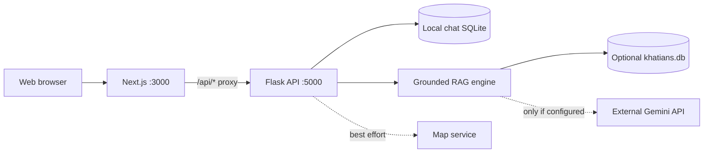

# Bangladesh Land AI Assistant

**A local-first bilingual land-record research workspace** built with **Next.js,
React, Flask, SQLite, an optional Gemini language-model provider, and Leaflet**.
Explore survey records, ask Bengali/English land-administration questions,
keep local conversations and inspect map geometries where a data source exists.

> **Important:** This is an independent software project, not a Bangladesh
> Government service or an authoritative title-verification system. The
> uploaded source archive did **not** include a production `khatians.db`
> database, and this repository does **not** claim to provide nationwide
> ownership coverage. A missing match is not evidence that a government record
> does not exist. Verify all records, legal guidance, service charges, and maps
> with the responsible official authorities before relying on them.

## What is included

| Feature | Implementation | Needs external data? |
| --- | --- | --- |
| AI-style Bengali/English chat | Rule-based record extraction, knowledge-base fallback, optional Gemini synthesis | No for general guidance; yes for record ownership facts |
| Khatian explorer | Text/field lookup, bounded pagination, record card details | Yes: compatible `khatians.db`, or explicit synthetic demo |
| Local conversation history | SQLite sessions, messages, rename-on-first-query, delete | No |
| Digital mouza map | Leaflet/OSM map, optional remote admin hierarchy and plot polygons | Internet/compatible map provider for remote polygons |
| Live status | Health endpoint and **actual** local DB counts | No |
| Selenium research ingestion | Explicitly disabled and admin-gated | Authorized, verified source + browser driver |
| Developer tooling | VS Code config, test suite, GitHub Actions, Docker, scripts | Dependencies on first run |

The optional language-model key is not required for offline knowledge-base
answers. Responses with missing record data must not be treated as validated
ownership findings. The external map integration is best-effort and its
availability/accuracy is not guaranteed.

## Quick start — Windows + VS Code

1. Install **Python 3.11+** and **Node.js 22** (Node.js 20.9+ is supported by
   Next 16; Node 22 is the recommended project baseline).
2. Extract this project and open the **`Bangladesh-Land-AI-Assistant` root
   folder** in VS Code.
3. Open `start_backend_windows.bat` (double-click). It creates `.venv`,
   installs `requirements.txt`, copies `.env.example` to `.env` if missing,
   and starts Flask on `http://127.0.0.1:5000`.
4. In another terminal/window, run `start_frontend_windows.bat` (double-click).
   It installs frontend packages when missing and starts the Next.js dev server.
5. Visit **http://localhost:3000** in the browser.

The first launch requires internet access to download Python/npm dependencies.
Keep both server windows open during development. Default startup is in
**knowledge-only mode** until a khatian database is added.

## Quick start — macOS/Linux

From two terminal windows at the project root:

```sh
./start_backend_unix.sh
```

```sh
./start_frontend_unix.sh
```

Check `http://127.0.0.1:5000/api/health` to inspect backend readiness.

## Try the fully offline demo data

Real ownership data is **not** bundled. To exercise the record explorer with
**synthetic examples only**, stop the backend and run:

```sh
python scripts/create_demo_db.py
python scripts/check_database.py
```

This creates `data/khatians.db` with four **fictional** entries. Every sample
record carries a `DEMO` data-source marker that the UI highlights. Restart the
backend and search `নমুনা মৌজা` or `প্রশিক্ষণ মৌজা` in the Record Explorer.
Do not use these demonstration entries for any genuine land transaction or
legal decision. The generator refuses to overwrite an existing database.

If you want to switch from demo mode to genuine records, stop the backend,
move your verified compatible database to `data/khatians.db` (or set
`KHATIAN_DB_PATH` in `.env`), then run the database validator. Confirm your
right to handle and publish any included personal ownership information.
Never commit `.db` files, API keys, conversation logs or personal data.

### Expected khatian database structure

The RAG search expects at minimum:

```text
khatian_index(khatian_id, survey_name, ...)
khatian_details(khatian_id, jl_number_id, survey_name, detail_json)
```

The JSON document includes fields such as `KHATIAN_NO`, `MOUZA_NAME`,
`DISTRICT_NAME`, `UPAZILA_NAME`, `OWNERS` and `DAGS`. Optional `plot_spatial_info`
/ `plot_polygons` tables enable local geometry matching only where a record has
an explicit matching mouza code. FTS5 indexes are created on first search if
needed; large database indexing can take time and should be prepared offline
before broad deployment. See `scripts/check_database.py`.

## Configuration

Copy `.env.example` to `.env` at root, and optionally copy
`frontend/.env.example` to `frontend/.env.local`.

| Variable | Default | Description |
| --- | --- | --- |
| `GEMINI_API_KEY` | empty | Optional language model; if supplied, selected question/data context may be sent to the provider |
| `GEMINI_MODEL` | `gemini-2.5-flash` in example | Model identifier; availability and billing depend on provider |
| `KHATIAN_DB_PATH` | `./data/khatians.db` | Local record database path |
| `LAND_DATA_DIR` | `./data` | Local chat and scraper runtime data directory |
| `BACKEND_URL` (frontend) | `http://127.0.0.1:5000` | Server-only Next.js proxy destination |
| `HOST` / `PORT` | `127.0.0.1` / `5000` | Flask bind address/port |
| `ENABLE_SCRAPER` | `false` | Must be explicitly enabled for research ingestion |
| `DLRMS_SOURCE_URL` | empty | **Verified, authorized** HTTPS site for optional adapter |
| `ADMIN_API_TOKEN` | empty | Secret token required by all scraper controls |

**Security model:** The default application is for *local development*. There
is no user authentication, tenant isolation, access-control system, or
production rate limiting for ordinary chat and search routes. Do **not** expose
the API or this demo to the public internet or host sensitive records without
adding authentication/authorization, HTTPS, privacy controls, backups,
monitoring, and a security review. The built-in scraper is off by default
and requires a configured admin token to initiate.

## Development checks

```sh
python -m compileall -q app.py chat_db.py rag_engine.py land_map_client.py
python -m unittest discover -s tests -v
cd frontend && npm run lint && npm run build
```

A GitHub Actions workflow (`.github/workflows/quality.yml`) runs Python tests,
Next lint and the frontend production build on pushes and pull requests.

## Docker (optional)

```sh
docker compose up --build
```

The app is available at `http://localhost:3000`. The backend is reachable only
by the frontend on the private Compose network, and runtime data persists
under `./data`. Stop with `docker compose down`.

## Architecture and API



See [docs/API.md](docs/API.md) for sample API requests and
[docs/ARCHITECTURE.md](docs/ARCHITECTURE.md) for data flow, module ownership,
privacy and integrity boundaries.

## Project structure

```text
Bangladesh-Land-AI-Assistant/
  app.py                    Flask API + safety controls
  rag_engine.py             Structured search + optional language synthesis
  land_knowledge_base.py    Bengali/English land knowledge
  land_map_client.py        Best-effort digital map integration
  chat_db.py                Persistent local chat sessions
  dlrms_scraper.py          Optional, disabled Selenium adapter
  frontend/                Next.js UI (chat, map, records)
  scripts/                 Explicit synthetic-demo generator + DB validator
  tests/                   Deterministic offline search tests
  docs/                    API, architecture, limitations
  legacy/                  Historical/experimental research scripts
  data/                    Ignored runtime data (not committed)
  .github/workflows/       CI quality checks
  .vscode/                 VS Code debug/task settings
```

## Current scope and limitations

The source archive supplied existing frontend, RAG, map and research scripts,
**but no usable production khatian database or official provider credentials**.
The upgraded repository is **runnable locally after installing dependencies**,
but live, nationwide record coverage is not deliverable without licensed,
verified data sources. Live map endpoints may change or be unavailable.

The assistant's procedural guidance is informational, not legal advice. Fees,
forms, deadlines and relevant legal rules may change. Reconfirm such facts
against current authority publications before using them. The repository also
contains isolated historical research scripts in `legacy/`; some originally
create simulated details and should **not** be treated as land-record evidence.

## License and attribution

Source code was upgraded from the user-provided prototype. The owner should
review third-party rights, dataset permissions and any prior obligations before
choosing a repository license or distributing data. No government affiliation
or official data endorsement is claimed.
